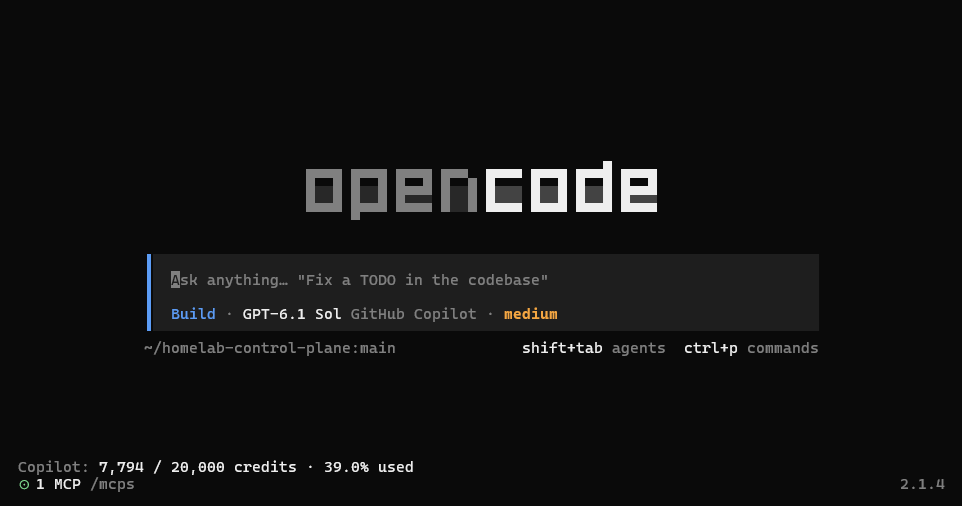
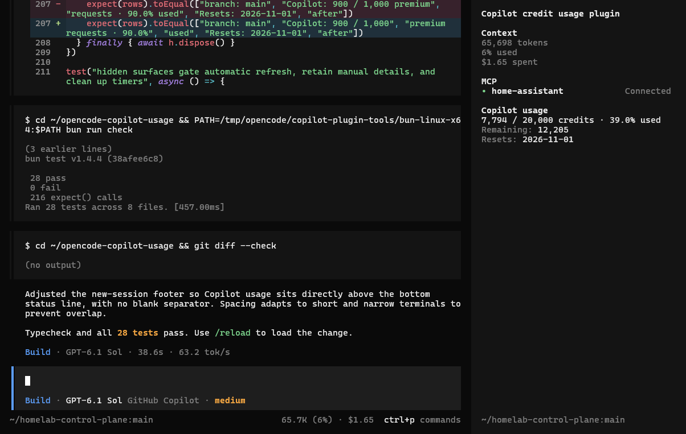

# Copilot usage for OpenCode

A standalone **OpenCode V2** plugin that shows your GitHub Copilot account quota
only while the selected model belongs to `github-copilot` or
`github-copilot-enterprise`.

- **Sessions:** adds a Copilot usage section to the existing sidebar.
- **New-session screen:** adds its own footer line above the bottom health/version
  row, with no blank separator. The existing branch, prompt status, MCP status,
  and version are untouched.
- **Details:** `/copilot-usage` or **Show Copilot account usage** in the command
  palette refreshes usage and opens account, plan, remaining quota, reset date,
  and update-time details when GitHub supplies them.

Example home-footer line:

```text
Copilot: 250 / 1,000 credits · 25.0% used
```

The label is **credits** only when GitHub reports token-based billing. Legacy
plans show **premium requests** instead. This is account-wide usage, not a
per-session cost estimate. Unknown values stay unknown; they are not reported as
zero. Unlimited plans are displayed as unlimited.

## Screenshots

### New-session footer

Copilot account usage sits directly above the existing bottom status line.



### Session sidebar

The Copilot usage section shows credits used, remaining quota, and the reset date
alongside the existing session information.



## Compatibility and placement

Built and typechecked against OpenCode **2.1.4**. Uses the supported V2 server,
custom RPC, and TUI plugin APIs; it does not support OpenCode V1.

OpenCode currently has no supported vertical slot directly below the branch
inside the prompt footer. All `prompt.footer` contributions share a horizontal
row. This plugin deliberately uses a separate `home.footer` contribution rather
than replacing existing information or mutating OpenCode's internal layout.

## Install from GitHub

Version **0.2.0** is available directly from this public GitHub repository; no
npm publication or manual clone is required. Merge this entry into your existing
`plugins` array in `~/.config/opencode/opencode.json(c)` (or the project
configuration for project-only scope):

```jsonc
{
  "$schema": "https://opencode.ai/config.json",
  "plugins": [
    "github:marcus-jan/opencode-copilot-usage#v0.2.0",
  ],
}
```

OpenCode installs the package and loads both its server and TUI entrypoints.
Preserve all existing settings and plugin entries, but replace any local-checkout
entry for this plugin rather than adding a second copy. **Do not add a duplicate
entry to `cli.json`.** GitHub installation requires no GitHub sign-in; accessing
your quota still requires the normal Copilot connection in OpenCode.

The `v0.2.0` tag selects this release. To upgrade later, change it to a newer
release tag. For a strict immutable pin, use a full Git commit hash instead.

Configuration changes are watched. Use `/reload` if you need to force a reload;
no service restart is needed. Select a Copilot model to see the quota. Sign in
to GitHub Copilot through OpenCode's normal provider connection flow if needed.

To remove it, remove only this plugin entry and save the config (or `/reload`).
No credentials or account state are written by this plugin.

### Local development installation

Clone this repository and run `bun install --frozen-lockfile` inside it. Use the
checkout's absolute directory path instead of the GitHub target:

```jsonc
{
  "$schema": "https://opencode.ai/config.json",
  "plugins": ["/absolute/path/opencode-copilot-usage"],
}
```

Configure the **directory**, not an individual source file. Root `index.ts` and
`tui.tsx` entrypoints support local loading; package exports provide the same
entrypoints for GitHub installation. With a remote OpenCode server, a local
directory must be available to the server and resolvable by the CLI.

### Display, colors, and refresh options

All options are optional. This example shows the defaults:

```jsonc
{
  "$schema": "https://opencode.ai/config.json",
  "plugins": [
    {
      "package": "github:marcus-jan/opencode-copilot-usage#v0.2.0",
      "options": {
        "refreshSeconds": 60,
        "colors": { "mode": "theme", "warningAt": 75, "criticalAt": 90 },
        "display": {
          "sidebar": { "enabled": true, "lines": ["title", "usage", "remaining", "reset"] },
          "home": { "enabled": true, "lines": ["usage"] },
        },
      },
    },
  ],
}
```

#### Choose lines independently

Both surfaces accept these IDs in the order you want them shown:

| ID | Content |
| --- | --- |
| `title` | Copilot usage heading |
| `usage` | Used / entitlement, unit, percentage, or unlimited/status text |
| `remaining` | Remaining quota (`?` if unknown) |
| `reset` | Reset date |
| `account` | Account login (opt-in) |
| `plan` | Plan name (opt-in) |
| `overage` | Overage, only when positive |
| `updated` | Last fetch time in local time |

For example, `"home": { "lines": ["usage", "reset"] }` adds two separate home
rows, while `"sidebar": { "lines": ["title", "account", "usage"] }` shows account
information only in the sidebar. Nested defaults merge independently.

Use `"enabled": false` to hide a surface but keep its line choices, or `"lines": []`
to hide it entirely. Missing optional fields do not leave blank rows. Unlimited
quotas omit remaining/overage lines. Enabled, nonempty surfaces always show a
loading, unavailable-quota, or error status even when `usage` is not selected.
The details command is independent of these filters and still shows all available
account information.

Unknown IDs are ignored, duplicates are removed in order, and invalid non-array
line lists fall back to defaults. Boolean flags must be actual booleans. Unknown
options are ignored.

#### Follow the current theme

- `theme` (default): muted labels, base-color values/headings, and semantic
  warning/error colors on usage at 75%/90% used. Retrieval errors use warning
  color and explicit error text. Live theme changes update the colors immediately.
- `muted`: all plugin text uses the current theme's muted foreground.
- `inherit`: no plugin foreground overrides; use the host's default foreground.

Customize thresholds with `warningAt` and `criticalAt`. They must be finite
numbers satisfying `0 <= warningAt < criticalAt <= 100`; an invalid pair resets
both to 75/90. Omitted thresholds retain their own defaults. Invalid color modes
fall back to `theme`. Unlimited and unknown percentages never trigger quota
severity. No hardcoded palette or custom background is used.

#### Refresh behavior

The interval defaults to 60 seconds, with a minimum of 30 seconds; for example,
set `"refreshSeconds": 120` to poll every two minutes. Invalid values use 60.
It also refreshes shortly after a successful turn in the current session.
Normal requests share a 30-second in-memory, account-scoped cache; manual and
post-turn refreshes bypass it. Concurrent requests are deduplicated. Polling does
not fetch usage while a non-Copilot provider is selected, or when both surfaces
are disabled/empty. `/copilot-usage` can still fetch manually when both are hidden.

## Privacy and limitations

- The server resolves the existing Copilot connection through OpenCode's
  integration API. No separate token, environment variable, or credential file
  is needed.
- GitHub OAuth credentials remain server-side. Only parsed usage fields cross
  the custom RPC channel. Tokens and raw responses are never logged or stored.
- Usage and credential fingerprints exist only in memory. Account changes use
  a different cache key; old account entries are discarded.
- Requests use HTTPS, reject redirects, time out after 10 seconds, and are
  aborted when the server plugin unloads. HTTP failures display a safe status,
  never a raw response body or exception.
- GitHub's `/copilot_internal/user` endpoint is undocumented and may change or
  omit fields for some plans. The UI displays unavailable/missing quota rather
  than guessing. GitHub may also update quota with a delay after a request.
- Enterprise hosts use the connection's `enterpriseUrl` metadata and the
  `https://api.<enterprise-host>` endpoint convention. Availability depends on
  the enterprise's GitHub configuration; this has not been live-tested.
- The sidebar contribution appears when OpenCode's sidebar is visible. This
  plugin does not force the sidebar open or change its visibility preferences.

## Development

Use Bun **1.3.14 or newer** (OpenTUI's minimum). If using Node-based tooling,
OpenTUI requires Node **26.4 or newer**.

```sh
bun install --frozen-lockfile
bun run check
```

The checks cover quota parsing, billing labels, missing and unlimited quotas,
provider matching, endpoint validation, credential handling, error sanitization,
account cache isolation, option normalization, ordered/hidden lines, fallback
statuses, thresholds, refresh gating, cleanup, and real headless OpenTUI renders.
Rendering tests switch providers, preserve host rows, exercise narrow widths,
and assert actual foreground colors across a live dark/light theme change.

Tests use synthetic credentials and mocked GitHub responses. No live Copilot
request or live OpenCode configuration change is made by the test suite.

## Implementation plan

See [ROADMAP.md](ROADMAP.md) for the implemented theme/display design and its
verification checklist. Interactive smoke testing inside OpenCode remains a
separate check from the automated headless tests.

## References and attribution

- [OpenCode V2 plugins](https://opencode.ai/v2/docs/build/plugins)
- [OpenCode V2 CLI plugins](https://opencode.ai/v2/docs/build/plugins/cli)
- [OpenCode V2 custom RPC](https://opencode.ai/v2/docs/build/plugins/rpc)
- Inspired by and adapts the quota endpoint/parsing approach from
  [murtuzaalisurti/opencode-github-copilot-usage](https://github.com/murtuzaalisurti/opencode-github-copilot-usage).
  See `NOTICE` and `LICENSE` for attribution and the MIT license.
